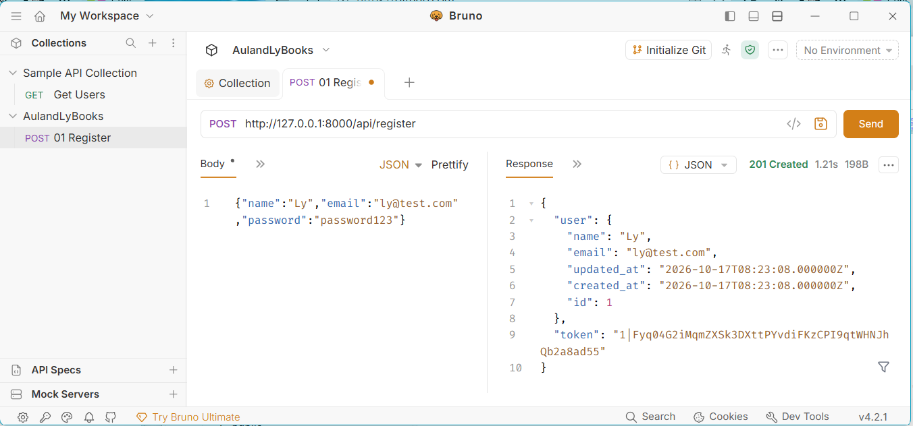
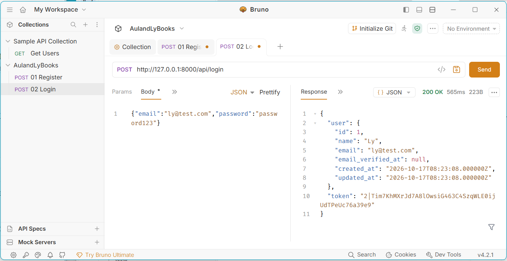
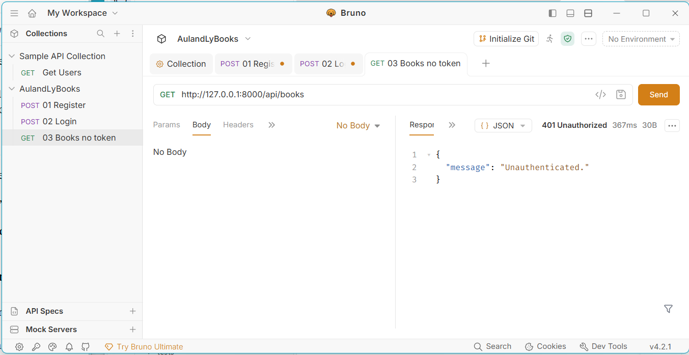
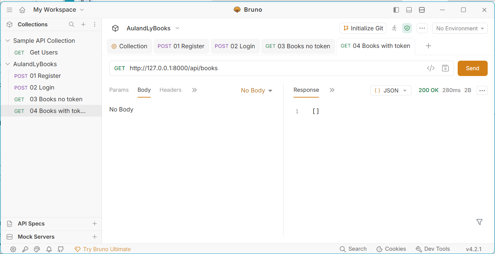
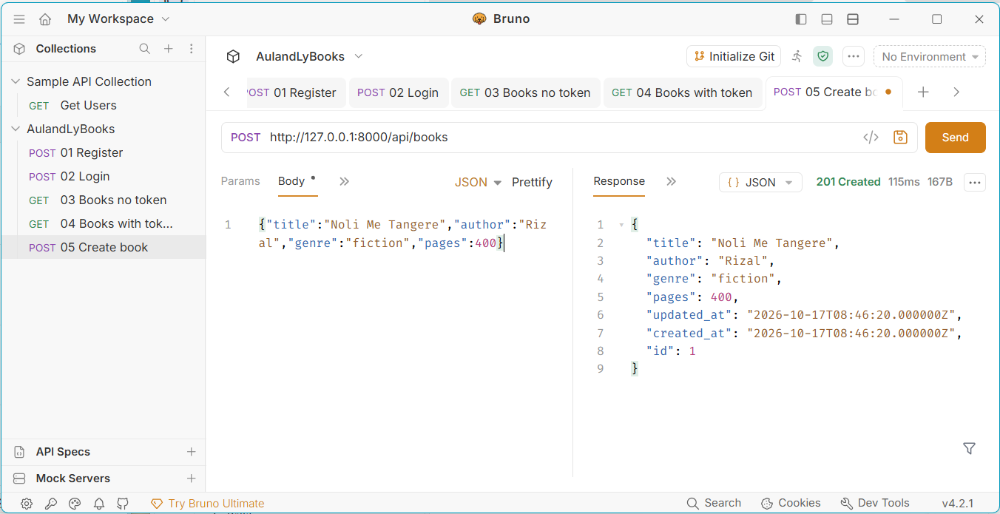
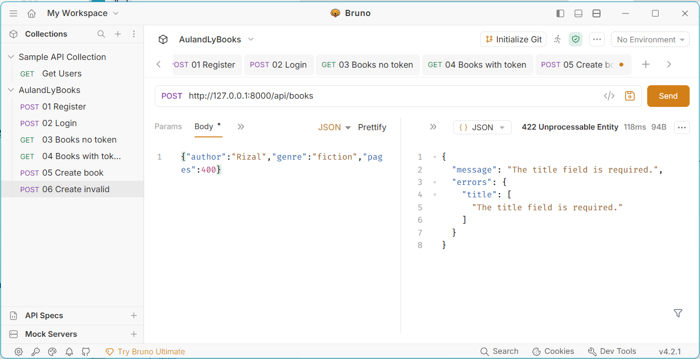
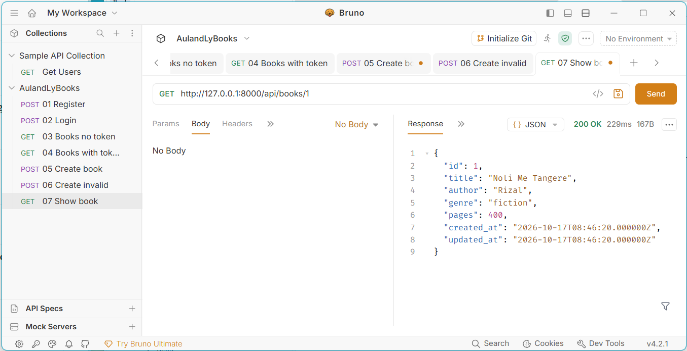
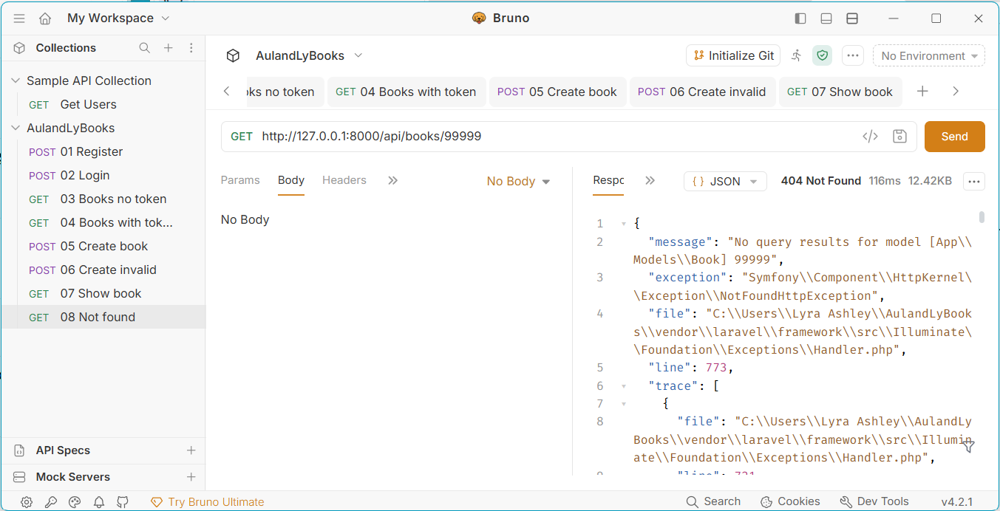
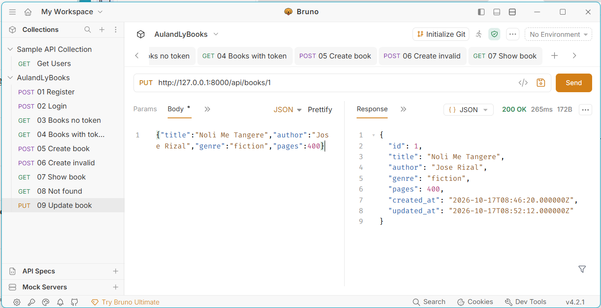
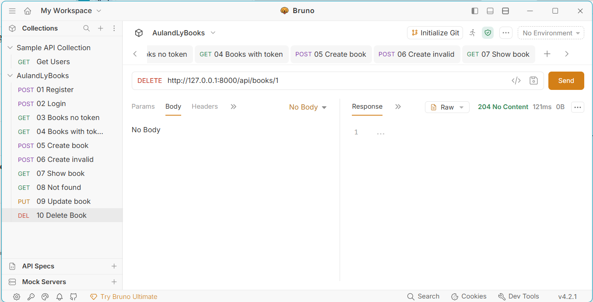

# cit3102-m5-book

**Course:** CIT_3102, Midterms Activity 2 (Build Your Own API)

**Partners:** Aulrich Espiritu and Lyra Embalsado

**Section:** IT3E

**Resource:** Book

This is a REST API for managing books, built with Laravel and Laravel Sanctum. Every book route needs a token, and users get a token by registering or logging in.

The Book resource has these fields:

| Field | Type |
|---|---|
| title | string |
| author | string |
| genre | string |
| pages | integer |

## Setup

These steps run the project from a fresh clone on Windows. The project uses SQLite, so MySQL is not needed.

### 1. Check the tools you need

Open PowerShell and run each of these. Each one should print a version number:

```
git --version
php -v
composer -V
```

- Git can be installed from https://git-scm.com/download/win
- PHP must be **8.4 or higher**. The project's packages (Laravel 13, Symfony 8, Pest 5) do not install on PHP 8.2 or 8.3.
- Composer needs PHP, so install PHP first. Laravel Herd (https://herd.laravel.com/windows) gives you PHP and Composer in one installer. Laragon also works.

If you installed PHP 8.4 but `php -v` still shows an older version, an older PHP (for example the one from XAMPP) is listed first in your PATH. Run `where.exe php` to see the order. To use the new one in the current window only, put its folder first:

```
$env:Path = "C:\path\to\php-folder;" + $env:Path
php -v
```

Close PowerShell and open a new one after installing anything.

### 2. Clone the repository

```
git clone https://github.com/Aulrich-tech/cit3102-m5-book.git
cd cit3102-m5-book
```

### 3. Install the dependencies

```
composer install
```

This takes a few minutes and creates the `vendor` folder. If it stops with "Your lock file does not contain a compatible set of packages", your PHP is older than 8.4. Go back to step 1.

### 4. Create the environment file

```
copy .env.example .env
```

On Mac or Linux, use `cp .env.example .env` instead.

### 5. Generate the app key

```
php artisan key:generate
```

### 6. Create the database tables

cit3102-m5-book

**Partners:** Aulrich Espiritu and Lyra Embalsado
**Section:** IT3E
**Resource:** Book (title, author, genre, pages)

## Setup

```bash
git clone https://github.com/Aulrich-Tech/cit3102-m5-book.git
cd cit3102-m5-book
composer install
copy .env.example .env
php artisan key:generate
php artisan migrate
php artisan serve
```
php artisan migrate
```

### 7. Start the server

```
php artisan serve
```

Keep this window open, because closing it stops the server. The API runs at `http://127.0.0.1:8000`.

### 8. Test the API

Use Bruno (https://www.usebruno.com/downloads) or any API client:

1. Add the header `Accept: application/json` to every request, so errors come back as JSON.
2. Send `POST /api/register` or `POST /api/login` and copy the `token` from the response.
3. For all the other routes, set the Bearer Token to that token.

## Routes

| Verb | Path | What it does | Needs token |
|---|---|---|---|
| POST | /api/register | Creates a new user and returns a token | No |
| POST | /api/login | Logs in a user and returns a token | No |
| POST | /api/logout | Deletes the current token | Yes |
| GET | /api/me | Shows the logged-in user | Yes |
| GET | /api/books | Lists all books, with optional filters ?genre= and ?author= | Yes |
| POST | /api/books | Creates a new book | Yes |
| GET | /api/books/{book} | Shows one book | Yes |
| PUT | /api/books/{book} | Updates one book | Yes |
| DELETE | /api/books/{book} | Deletes one book | Yes |

## Screenshots

### 1. POST /api/register returns 201



### 2. POST /api/login returns 200



### 3. GET /api/books with no token returns 401



### 4. GET /api/books with the token returns 200



### 5. POST /api/books with valid data returns 201



### 6. POST /api/books with a required field missing returns 422



### 7. GET /api/books/1 returns 200



### 8. GET /api/books/99999 returns 404



### 9. PUT /api/books/1 with changed data returns 200



### 10. DELETE /api/books/1 returns 204



## Why does DELETE return 204 and not 200?

DELETE returns 204 because the request worked and there is nothing left to send back. The book is already gone after the delete, so there is no record to show in the response. A 200 response is for requests that come back with something to read, like the book data in a GET or PUT. The 204 No Content status tells the client that the delete succeeded and that it does not need to look for a response body.
## Routes

| Verb | Path | What it does | Token needed? |
|---|---|---|---|
| POST | /api/register | Creates a user and returns a token | No |
| POST | /api/login | Logs in and returns a token | No |
| POST | /api/logout | Deletes the current token | Yes |
| GET | /api/me | Shows the logged-in user | Yes |
| GET | /api/books | Lists books (filter with ?genre= and ?author=) | Yes |
| POST | /api/books | Creates a book | Yes |
| GET | /api/books/{book} | Shows one book | Yes |
| PUT | /api/books/{book} | Updates a book | Yes |
| DELETE | /api/books/{book} | Deletes a book | Yes |

## Screenshots

1. Register (201)


2. Login (200)


(continue the same way for 3 to 10)

## Why does DELETE return 204 and not 200?

(Write 3 to 5 sentences here in your own words.)
